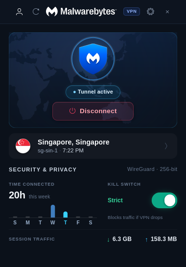

# Malwarebytes Privacy VPN for Linux (GUI)

[](https://archlinux.org)
[](https://gnome.pages.gitlab.gnome.org/libadwaita/)
[](https://www.wireguard.com)
[](LICENSE)

A tier-1 native Linux desktop client for **Malwarebytes Privacy VPN**, engineered with **GTK 4**, **Libadwaita**, and **StatusNotifierItem (SNI)** on top of the official `mbvpn` WireGuard engine. Built specifically for Arch Linux, Hyprland, and modern Wayland/X11 desktop environments.

<p align="center">
  
</p>

---

## Highlights & Features

### 🛡️ Cyber UI & Dynamic Shield State Engine
- **State-Reactive Hero Shield**: Sapphire core glow and radiant containment ring when **PROTECTED**, dimmed with a subtle warm perimeter hairline when **UNPROTECTED**, and a breathing halo with rotating sweep animation during connection handshakes.
- **Clean Borderless Location Bar**: Displays country flag, city name, server ID, and real-time local server time in a minimalist, distraction-free container.
- **Real-Time Telemetry**: Live incoming/outgoing bandwidth metrics and weekly connection duration charts.

### ⚡ Zero-Password & Zero-Leak WireGuard
- Direct **NetworkManager WireGuard** integration utilizing Malwarebytes's official internal gateway DNS (`10.0.0.1`) with catch-all routing (`~.`) and prioritized lookup order (`-50`).
- Eliminates repeated `sudo` or Polkit authentication dialogs on connect/disconnect.
- Complete DNS leak prevention validated against DNS leak audit services.

### 🔒 Linux Kernel Kill Switch (nftables)
- Intelligently differentiates between **Armed** (primed when VPN activates) and **Active** (tunnel running).
- Never blocks or cuts physical internet when the VPN is manually disconnected.
- Isolates raw network traffic automatically if the WireGuard tunnel drops unexpectedly.

### 🎭 Hardware Privacy & MAC Randomizer
- One-click instant spoofing and rotation to compliant locally-administered unicast MAC addresses.
- Automatic per-network Wi-Fi MAC address randomization across access points.
- Instant restore to factory permanent hardware MAC without interrupting active sessions.

### 🌍 Global Server Infrastructure
- Complete database of **36 countries, 62 cities, and 149 WireGuard servers**.
- Real-time search with instant keyboard filtering.
- One-click *Fastest Location (Auto)* selection based on ping latency.

### 🔔 Native System Tray Integration (SNI)
- Full **StatusNotifierItem (SNI)** support for Waybar, Quickshell, Hyprland, and desktop panels.
- Status shield icon reflects tunnel state directly in your bar.
- Left-click toggles dashboard visibility; middle-click toggles tunnel state.
- Right-click quick context menu with recent locations and one-click disconnect.
- Closing window minimizes cleanly to system tray without interrupting active connections.

### 📋 Account & License Management
- Inspect active subscription plan, device seat status, and precise license expiration countdown.
- Master License Key and pairing code support.
- One-click copy buttons for internal WireGuard IPs, public gateway IPs, and Machine IDs.

---

## Arch Linux Installation

### Method 1: Using `makepkg` (Recommended)

Clone the repository and build the Arch package locally:

```bash
git clone https://github.com/thedrybyte/mbvpn-gui.git
cd mbvpn-gui
makepkg -si
```

This builds and installs:
- Executable binary to `/usr/bin/mbvpn-gui`
- Kernel firewall helper to `/usr/bin/mbvpn-firewall`
- Desktop entry to `/usr/share/applications/org.paradoxbyte.mbvpn.desktop`
- Vector and multi-size application icons to `/usr/share/icons/hicolor/`
- Polkit DNS rule to `/usr/share/polkit-1/rules.d/10-mbvpn.rules`

### Method 2: Standalone User Install (`setup.sh`)

If you prefer installing directly into your user home directory without packaging:

```bash
git clone https://github.com/thedrybyte/mbvpn-gui.git
cd mbvpn-gui
./setup.sh
```

This installs to `~/.local/bin/mbvpn-gui` and `~/.local/share/mbvpn-gui` and registers user desktop icons automatically.

---

## Dependencies

### Arch Linux (`pacman`)

```bash
sudo pacman -S --needed \
    python \
    python-gobject \
    gtk4 \
    libadwaita \
    networkmanager \
    wireguard-tools \
    nftables \
    python-cairo \
    gcc
```

### Official WireGuard Backend Binary

The client utilizes the official Malwarebytes `mbvpn` CLI utility. If not already installed, `setup.sh` will automatically fetch it, or you can place it in your `PATH` or `~/.local/bin/mbvpn`:

```bash
mkdir -p ~/.local/bin
curl -sL https://github.com/Malwarebytes/mbvpn-linux/releases/download/v0.2.1/mbvpn-linux_0.2.1_linux_amd64.tar.gz | tar -xz -C ~/.local/bin mbvpn
chmod +x ~/.local/bin/mbvpn
```

### One-Time Permission Setup

To allow passwordless WireGuard configuration and firewall rule management:

```bash
sudo setcap cap_net_admin,cap_net_raw+eip $(which mbvpn || echo ~/.local/bin/mbvpn)
sudo setcap cap_net_admin,cap_net_raw+eip $(which mbvpn-firewall || echo ~/.local/bin/mbvpn-firewall)
sudo cp 10-mbvpn.rules /etc/polkit-1/rules.d/
```

*(Note: When installing via `makepkg -si`, the package installation script handles firewall helper capabilities automatically).*

---

## Usage

Launch the client from terminal or your desktop application launcher:

```bash
mbvpn-gui
```

Or search for **MalwarebytesVPN** in `wofi`, `rofi`, `tofi`, or GNOME Application Overview.

### Running Interactive QA Tests

A test suite verifying all UI modals, telemetry counters, and server lists is included:

```bash
python3 test_interactive.py
```

---

## Project Structure

```
mbvpn-gui/
├── PKGBUILD                       # Arch Linux package build script
├── mbvpn-gui.install              # Arch post-install script (capabilities & caches)
├── .SRCINFO                       # Arch Linux package metadata
├── setup.sh                       # Automated standalone installer
├── bin/
│   └── mbvpn-gui                  # Portable application launcher wrapper
├── app.py                         # GTK4 / Libadwaita UI & application controller
├── backend.py                     # WireGuard & NetworkManager backend engine
├── tray.py                        # StatusNotifierItem (SNI) D-Bus system tray
├── firewall.c                     # High-performance Linux nftables Kill Switch helper
├── 10-mbvpn.rules                 # Polkit policy for passwordless systemd-resolved
├── org.paradoxbyte.mbvpn.desktop  # XDG desktop entry
├── mbvpn.svg                      # Scalable application icon
├── assets/                        # Multi-res icons, country flags & server metadata
├── test_interactive.py            # Comprehensive interactive QA test suite
├── LICENSE                        # GNU General Public License v3.0
└── README.md                      # Project documentation
```

---

## License

This project is licensed under the [GNU General Public License v3.0](LICENSE).

### Disclaimer
*This is an independent open-source client for Linux desktops. Malwarebytes and Malwarebytes Privacy VPN are registered trademarks of Malwarebytes Inc. This project is not officially affiliated with or endorsed by Malwarebytes Inc.*
